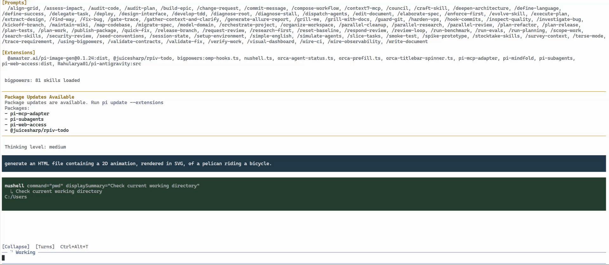
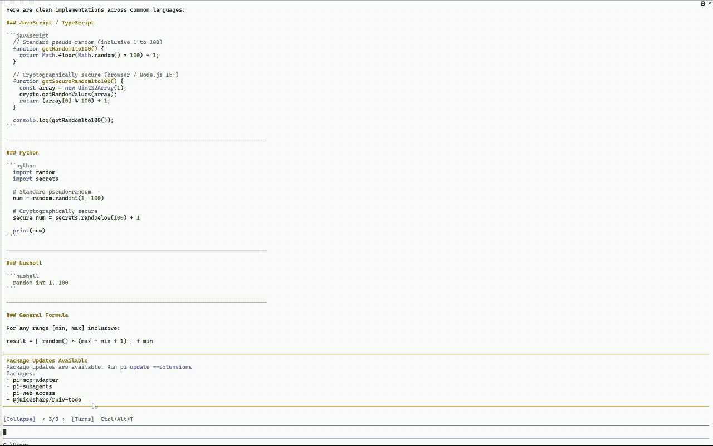

# pi-mindfold

Keep Pi conversations readable, then jump straight to the answer you need.

[](https://www.npmjs.com/package/pi-mindfold)
[](./COMPATIBILITY.md)
[](./LICENSE)

[简体中文](./README.zh-CN.md) · [Features](#features) · [Install and run](#install-and-run) · [Controls](#controls)

Mindfold is an extension for [Pi Coding Agent](https://github.com/earendil-works/pi). It folds long thinking and tool output into one current activity, shows why that activity is happening, and keeps the assistant's response readable. When a conversation grows, open **Turns** to find an earlier request by its purpose and jump to its answer.

## See it in action

### Collapse: follow the current activity

Thinking and tool cards replace each other as work progresses. Earlier activity stays folded while the assistant's text remains visible.

<p align="center">
  
</p>

### Turns: find an earlier answer

Open **Turn History**, choose a request by its short intent summary, and jump to that turn's response.

<p align="center">
  
</p>

## Features

- **One current activity** — see thinking or the latest started tool, with a short purpose label.
- **Readable answers** — keep assistant text visible while earlier thinking and tool cards stay folded.
- **Full history on demand** — expand a turn's received thinking, tools, results, and nested tool calls.
- **Useful scroll positions** — expand at the turn's end; use `↑` to revisit its beginning.
- **A directory of requests** — browse intent summaries and jump directly to earlier answers.
- **Automatic intent language** — Chinese requests get Chinese labels; other languages get English labels.
- **Session recovery** — retain saved intent summaries and tool records when reloading or resuming.
- **No extra model requests** — generate intent labels within normal responses and tool calls.

## Install and run

### 1. Install the extension

You need Node.js **22.19 or newer** and a working [Pi CLI installation](https://github.com/earendil-works/pi#readme). Mindfold is tested with Pi **1.0.0** and **1.3.0**, using one active CLI session per process.

```sh
pi install npm:pi-mindfold
```

This installs the latest **published npm release**. To run the features in a local checkout, install that checkout instead:

```sh
cd pi-mindfold
pi install .
```

To install the GitHub version directly:

```sh
pi install git:github.com/yoggsaron010-lang/pi-mindfold
```

Choose one installation source so Pi loads one copy of Mindfold.

### 2. Start Pi

```sh
pi
```

If Pi is already running, enter `/reload` to load the extension. Restart Pi if you also upgraded Pi itself. Use your existing Pi model connection; Mindfold needs no additional API key.

For clickable buttons, the Turns menu, and automatic scroll positioning, use Pi's **fullscreen** mode. If needed, set `"tuiMode": "fullscreen"` in `~/.pi/agent/settings.json` and restart Pi. On Windows, that file is at `%USERPROFILE%\.pi\agent\settings.json`. Regular mode supports folding through the shortcut and slash commands; it leaves scrolling to the terminal.

### 3. Send a request

For example, ask Pi:

```text
Inspect this project and explain how to run its tests.
```

The control bar appears above the editor:

```text
[Collapse]  ‹ 1/3 ›  [Turns]  Ctrl+Alt+T
```

`1/3` means turn 1 is selected out of 3 available turns. A turn covers one user request and the tool work needed to answer it.

## Use Mindfold

### Follow work in Collapse mode

New requests start collapsed. Thinking first appears as `Thinking`; when the model supplies a public progress label, it becomes something like:

```text
Thinking — Check the test setup
```

A tool starting replaces that label with its tool card and intent:

```text
read package.json
  ↳ Find the test command
```

For parallel tools, the latest started tool remains the current activity even if an older one finishes later. When the request finishes, the thinking placeholder disappears and the last tool card remains beside the assistant's response.

If the model provides no progress label, `Thinking` stays as-is. Tool calls without an intent use a short fallback label.

### Expand a turn and revisit its beginning

Click `[Collapse]` or press `Ctrl+Alt+T` to reveal the selected turn's history:

```text
[Expanded] ↑  ‹ 1/3 ›  [Turns]  Ctrl+Alt+T
```

Expansion scrolls to **that turn's end**, so you can read the output immediately. Click `↑` to go back to its earliest thinking or tool activity. Collapse again to keep your current position in the response where possible; when viewing thinking or tools, collapsing returns to the turn's end. The editor keeps focus.

Expansion shows the thinking and tool output Pi actually received. Content already truncated by a tool or withheld by a model is unavailable.

### Browse requests with Turns

Click `[Turns]` or enter `/mindfold turns`. The directory opens upward, showing a turn number and a one-sentence description of the user's goal.

- Click a row, or use `↑` / `↓` and `Enter`, to jump to its response.
- Use the mouse wheel to browse; the menu shows up to eight entries at a time.
- `●` marks the selected turn. `Esc` closes the menu.
- Typing closes the menu and continues in the editor.

New turn summaries come from the model's normal response. Older turns and responses without a summary show a short preview of the original user message. Labels use a few output tokens and require no separate model call.

For adjacent turns, click `‹` or `›`. Both the arrows and Turns entries jump to the **start of the response body**, preserving that turn's expanded or collapsed state. Navigation covers the active session branch and the turns retained after context compaction.

## Controls

| Action | Button or shortcut | Command |
|---|---|---|
| Toggle the selected turn | `[Collapse]` / `[Expanded]`, `Ctrl+Alt+T` | `/mindfold toggle` |
| Expand and read the turn's end | Click `[Collapse]` | `/mindfold expand` |
| Collapse the selected turn | Click `[Expanded]` | `/mindfold collapse` |
| Go to the turn's beginning | `↑` beside `[Expanded]` | `/mindfold start` |
| Jump to the previous / next answer | `‹` / `›` | `/mindfold prev`, `/mindfold next` |
| Open or close the request directory | `[Turns]` | `/mindfold turns` |
| Check extension status | — | `/mindfold status` |

`/mindfold` alone also toggles the selected turn. `/compact-thinking` is an alias.

## Resume, back up, or remove

Resume a session through Pi as usual; Mindfold restores its available turn titles and saved tool records. When copying or backing up session files, **keep the `.mindfold/` folder alongside them**: large tool display records are stored there.

To uninstall, pass the same source you installed from, then run `/reload` or restart Pi:

```sh
pi remove npm:pi-mindfold
```

For a GitHub installation, use `pi remove git:github.com/yoggsaron010-lang/pi-mindfold`. For a local installation, pass its directory path. Existing session records remain on disk.

## Documentation and contributing

See the [compatibility notes](./COMPATIBILITY.md), [verification notes](./VERIFICATION.md), and [Pi documentation](https://github.com/earendil-works/pi#readme). Report problems through [GitHub Issues](https://github.com/yoggsaron010-lang/pi-mindfold/issues) or submit a pull request.

To check a local change, use Node.js 22.19+ with Pi installed:

```sh
npm test
npm run check
```

Tests find Pi's managed installation automatically. For another installation layout, set `COMPACT_PI_ROOT` to the installed `@earendil-works/pi-coding-agent` package directory before running `npm test`.

## Credits and license

Thanks to [@Nyarlathoteppppp](https://github.com/Nyarlathoteppppp) and [pi-tool-explain](https://github.com/Nyarlathoteppppp/pi-tool-explain) for the intent and display code used by Mindfold. Upstream work includes [MasuRii's pi-tool-display](https://github.com/MasuRii) and [Mert Deveci's pi-tool-display-summary](https://github.com/mertdeveci5). See [THIRD_PARTY.md](./THIRD_PARTY.md) for notices.

[MIT License](./LICENSE).
